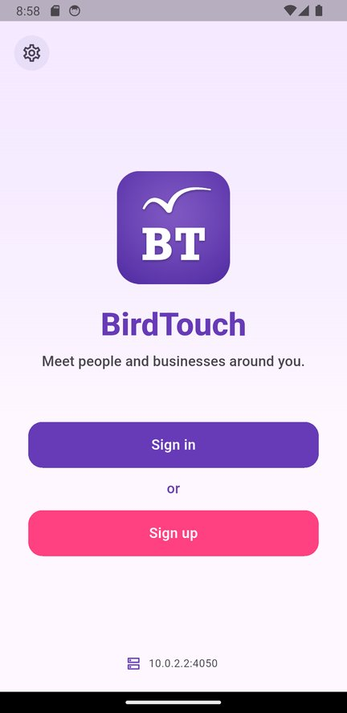
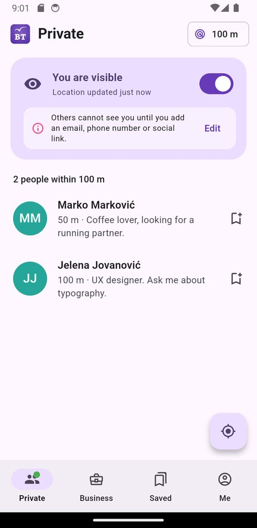
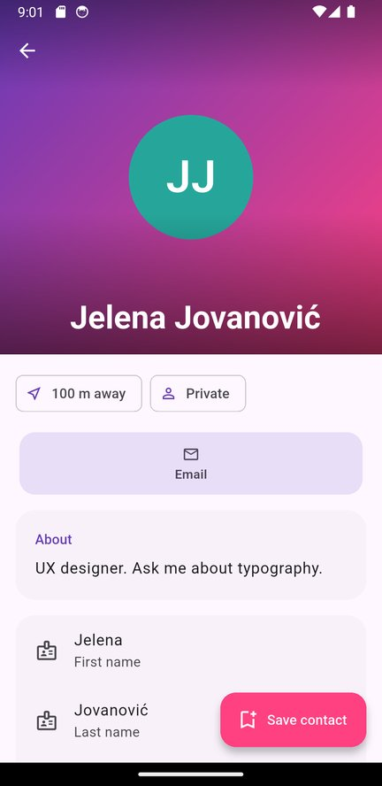
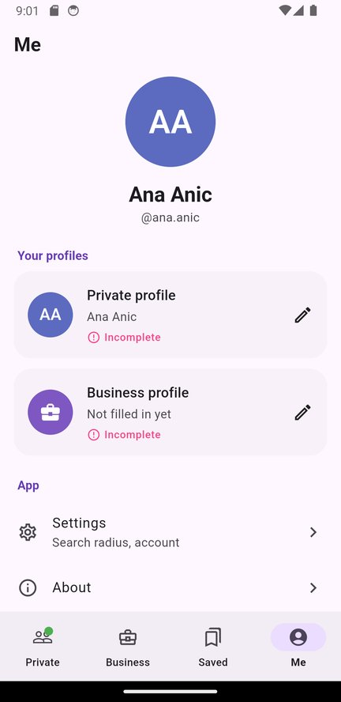

# BirdTouch

BirdTouch is a mobile app for **Android and iOS** that shows you people and businesses around you.
Make yourself visible, and see who else nearby is visible. Use the **private** mode to meet people,
and the **business** mode to find companies and business contacts. Save the people you meet as
contacts to find them later.

The app is written in [Flutter](https://flutter.dev) (one codebase for both platforms). It needs the
[BirdTouch-WebAPI](https://github.com/ilic5000/BirdTouch-WebAPI) server (FastAPI + PostgreSQL).

<p>
  &nbsp;
  &nbsp;
  &nbsp;
  
</p>

> Version 2 replaces the original Xamarin (Android only) app. That code is still in the git history
> and on the `master` branch before the migration. See [What changed from the Xamarin app](#what-changed-from-the-xamarin-app).

## Contents

- [Features](#features)
- [Requirements](#requirements)
- [Quick start](#quick-start)
- [Configuration](#configuration)
- [Running in debug mode](#running-in-debug-mode)
- [Testing](#testing)
- [Builds for test users](#builds-for-test-users)
- [Release builds](#release-builds)
- [Project structure](#project-structure)
- [What changed from the Xamarin app](#what-changed-from-the-xamarin-app)
- [Troubleshooting](#troubleshooting)

## Features

- Sign up (with a live "username available" check) and sign in. The login is kept in the platform's
  secure storage (Keychain / Android Keystore) and lasts 30 days.
- **Private** and **Business** tabs: a "Make me visible" switch per mode, and the users visible
  nearby, nearest first, with their distance. Pull to refresh, or tap the location button.
- While visible, the address others see you at (looked up on the device), and a **Map** of the
  people nearby: their pictures and names around your own position and the search radius. Tap
  someone to open their profile. Maps use OpenStreetMap tiles by default (see the settings below).
- While you are visible and the app is open, your location is sent every 5 minutes. The server
  hides users who stop sending it (24 hours by default). Location is never used in the background.
- Profile of another user: call, email, website and map buttons, social links, save/remove.
- **Saved** contacts, private and business, stored on the server (the same on every device).
  Swipe to remove, with undo.
- **Me**: edit your private and business profiles, with a profile picture per mode (tap the
  picture; from the gallery or the camera, cropped to a square and scaled down on the device). The app tells you when a profile is too
  incomplete for others to see it.
- Settings: search radius (10 m to 10 km), account deletion.
- Server address can be changed in the app (gear icon on the welcome screen).
- Developer options for testers (see [below](#developer-options-in-the-app)).
- Light and dark theme (follows the system), Material 3 design in the original purple and pink.

## Requirements

- [Flutter](https://docs.flutter.dev/get-started/install) 3.44 or newer (stable channel), with
  Dart 3.12 or newer. `flutter doctor` must be green for the platforms you build.
- **Android:** Android Studio (or the Android SDK command line tools) and Java 17. Android 7.0
  (API 24) or newer on the device.
- **iOS:** a Mac with Xcode 16 or newer. iOS 13 or newer on the device. iOS apps can only be built
  on macOS.
- A running [BirdTouch-WebAPI](https://github.com/ilic5000/BirdTouch-WebAPI) server. For local
  development: `docker compose up -d --build` in the server repository (API on port 4050).

## Quick start

```sh
flutter pub get
flutter run --dart-define-from-file=dart_defines/local.example.json   # Android emulator + local server
```

`flutter run` asks which device to use if more than one is connected (`flutter devices` lists them).

## Configuration

### Server address

The app talks to one BirdTouch server. Its address is chosen like this:

1. The address the user saved in the app (gear icon on the welcome screen, or **Settings >
   Developer options > Server**). Saving tests the connection (`GET /health`). Changing the server
   signs you out, because a login belongs to one server.
2. Otherwise the build-time default, `BIRDTOUCH_API_URL`.
3. Otherwise `http://160.99.21.233:4050`.

### Build-time settings

Build-time settings are passed with `--dart-define` or, simpler, a JSON file with
`--dart-define-from-file`. The files are in [`dart_defines/`](dart_defines):

| File                                                           | Server                        | Developer options |
| -------------------------------------------------------------- | ----------------------------- | ----------------- |
| [`local.example.json`](dart_defines/local.example.json)        | `http://10.0.2.2:4050` (your computer, seen from the Android emulator) | on |
| [`production.example.json`](dart_defines/production.example.json) | `http://160.99.21.233:4050`   | on (for now, see below) |

| Setting                 | Default                      | Description                                      |
| ----------------------- | ---------------------------- | ------------------------------------------------ |
| `BIRDTOUCH_API_URL`     | `http://160.99.21.233:4050`  | Default server address                           |
| `BIRDTOUCH_DEV_OPTIONS` | `true` (while in testing; set `false` for a public release) | Developer options unlocked on first start |
| `BIRDTOUCH_MAP_TILES_URL` | `https://tile.openstreetmap.org/{z}/{x}/{y}.png` | Map tiles (URL template). OpenStreetMap's servers are for light use only ([policy](https://operations.osmfoundation.org/policies/tiles/)); use another provider for a public release |
| `BIRDTOUCH_MAP_ATTRIBUTION` | `OpenStreetMap contributors` | Credit shown on the maps, as the tile provider requires |

For your own settings, copy an example to e.g. `dart_defines/local.json`. Files without `.example`
are not committed (`.gitignore`).

Other constants (location refresh interval, picture size, ...) are in
[`lib/config/app_config.dart`](lib/config/app_config.dart).

### Plain HTTP

Test servers usually run on plain `http://ip:port`, so the app allows unencrypted HTTP
(`android:usesCleartextTraffic` on Android, `NSAllowsArbitraryLoads` on iOS). When the production
server gets HTTPS, remove both, otherwise App Store review may ask why they are needed:

- `android/app/src/main/AndroidManifest.xml`: `android:usesCleartextTraffic="true"`
- `ios/Runner/Info.plist`: the `NSAppTransportSecurity` entry

## Running in debug mode

Debug mode gives you hot reload (`r` in the terminal), the Flutter DevTools and the debug console.
Every API request is logged there on one line, e.g. `[api] 200 GET /api/v1/nearby/private`.

In **VS Code** (with the Flutter extension) use the configurations in the *Run and Debug* panel
(`.vscode/launch.json`): *local server*, *production server* and *profile mode*. In **Android
Studio**, add `--dart-define-from-file=dart_defines/local.example.json` to *Additional run args*
of the run configuration.

### Android

**Emulator:**

```sh
flutter emulators                                  # list emulators
flutter emulators --launch <emulator id>           # or start one from Android Studio's Device Manager
flutter run --dart-define-from-file=dart_defines/local.example.json
```

The emulator reaches your computer at `10.0.2.2`, so a server started with Docker on your computer
is `http://10.0.2.2:4050`.

The emulator has no real location. Set one in the emulator's *Extended controls > Location*, or:

```sh
adb emu geo fix 20.4569 44.8176        # longitude first, then latitude (Belgrade)
```

**Phone:**

1. Enable *Developer options* (tap *Build number* 7 times in *Settings > About phone*) and turn on
   *USB debugging*.
2. Connect the phone with USB and accept the prompt on the phone. `flutter devices` should list it.
3. The phone must reach the server. `10.0.2.2` does not work on a phone: use your computer's LAN
   address (e.g. `http://192.168.1.10:4050`, phone and computer on the same Wi-Fi) or a public
   server. Pass it with `--dart-define=BIRDTOUCH_API_URL=http://192.168.1.10:4050`, or set it in
   the app with the gear icon.
4. `flutter run`

Debug builds install as a separate app, **BirdTouch Debug** (`rs.birdtouch.birdtouch.debug`), so
they don't replace a release build on the same phone.

### iOS (macOS only)

```sh
open -a Simulator                                  # start the iOS Simulator
flutter run --dart-define=BIRDTOUCH_API_URL=http://localhost:4050
```

The iOS Simulator shares the Mac's network, so a local server is `http://localhost:4050`. Set the
simulated location in the Simulator menu: *Features > Location > Custom Location...*

**iPhone:**

1. Open `ios/Runner.xcworkspace` in Xcode. In *Runner > Signing & Capabilities*, choose your team
   (a free Apple ID works for your own devices) and, if needed, a unique *Bundle Identifier*.
2. Connect the iPhone, trust the computer, and turn on *Developer Mode* on the phone (*Settings >
   Privacy & Security*).
3. `flutter run --dart-define=BIRDTOUCH_API_URL=http://<your Mac's LAN IP>:4050`
4. The first time, trust the developer on the phone: *Settings > General > VPN & Device Management*.

### Someone to find: demo users

A nearby list is only interesting with someone in it. [`tool/seed_demo_users.py`](tool/seed_demo_users.py)
(Python 3, no dependencies) creates four demo users, visible around a location, in private and
business mode:

```sh
python tool/seed_demo_users.py                                   # local server, Belgrade centre
python tool/seed_demo_users.py --server http://160.99.21.233:4050 --lat 45.2671 --lon 19.8335
python tool/seed_demo_users.py --delete                          # remove them again
```

Put the emulator or simulator at the same place (see above), make yourself visible, and they show
up. Run the script again after 24 hours: the server hides users whose location is older than that.
To test with two real accounts, run the app on two devices (or an emulator and a phone) at the
same location.

### Developer options in the app

They are on by default while the app is in testing (`BIRDTOUCH_DEV_OPTIONS`). **Long-press the
"Settings" title** in *Me > Settings* to toggle them (as in the old app). They add:

- search radius up to 500 km, or unlimited (useful when testers are in different cities);
- the server address, and a link to the server's API documentation (`/docs`);
- showing the introduction again;
- the build mode;
- a fake location, chosen on a map or typed as coordinates, used instead of the device's (sent to
  the server right away; marked "Fake" in the app). Off again with *Use device*, or by turning the
  developer options off;
- signing out while staying visible to others, e.g. to set up test users and then look for them
  from another account (a checkbox in the sign out dialog; the server hides them after 24 hours).

## Testing

```sh
flutter analyze                     # static analysis (lints in analysis_options.yaml)
dart format lib test                # formatting (CI checks it)
flutter test                        # unit and widget tests, no server or device needed
flutter test --coverage             # the same, with coverage in coverage/lcov.info
```

| Tests                                            | What                                                         |
| ------------------------------------------------ | ------------------------------------------------------------ |
| [`test/utils_test.dart`](test/utils_test.dart)   | Validators (same rules as the server), formatting, links     |
| [`test/models_test.dart`](test/models_test.dart) | JSON parsing, partial updates, discoverability rules         |
| [`test/api_test.dart`](test/api_test.dart)       | Requests the API client sends, error handling, sign out on `401`, contacts |
| [`test/app_test.dart`](test/app_test.dart)       | The app's screens with a fake API and location: sign in, going visible, saving a contact, missing location permission, expired session |
| [`test/e2e/api_e2e_test.dart`](test/e2e/api_e2e_test.dart) | The API client against a real server (skipped unless configured) |

### End-to-end tests against a server

The end-to-end test registers two throwaway users and goes through every endpoint: profiles,
pictures, visibility, nearby search, contacts, account deletion. It deletes the users at the end.

```sh
# Server running locally (docker compose up -d in BirdTouch-WebAPI)
BIRDTOUCH_E2E_URL=http://localhost:4050 flutter test test/e2e          # macOS / Linux / Git Bash
$env:BIRDTOUCH_E2E_URL="http://localhost:4050"; flutter test test/e2e  # PowerShell
```

### Manual test on devices

Before a release, check on at least one Android and one iOS device (or emulator and simulator):

1. Sign up; sign out; sign in. Wrong password shows an error.
2. Server settings: a wrong address fails the test; the right one connects.
3. Private tab: turn on visibility. The first time the app asks for the location permission.
   Deny it once: a message explains why it's needed. With demo users nearby, they appear with
   their distance.
4. Open a user: call, email, map and social buttons open the right apps. Save the user; they
   appear under **Saved**. Swipe to remove, then *Undo*.
5. Edit both profiles, add a picture from the gallery and from the camera (tap the picture, crop
   it), remove it. Clear a field
   and save: it stays empty after pull to refresh.
6. Business tab: the same with the business profile. Open the **Map**: you, the radius circle and
   the demo users; tap one to open their profile. In the developer options, set a fake location in
   another part of town and check that the list and the map follow.
7. Settings: change the radius; the lists reload. Long-press the title: developer options appear.
8. Put the app in the background and back: the visibility and lists are restored.
9. Delete the account: you are back on the welcome screen and cannot sign in with it anymore.

## Builds for test users

A test build is a normal release build: fast, and without the debug banner. Build it with the
settings of the server the testers use, e.g.:

```sh
flutter build apk --release --dart-define-from-file=dart_defines/production.example.json
```

The developer options are on by default while the app is in testing. Users can turn them off
(or on again) by long-pressing the "Settings" title. Before a public release, set
`BIRDTOUCH_DEV_OPTIONS` to `false` in `lib/config/app_config.dart` and
[`production.example.json`](dart_defines/production.example.json).

Use `--build-number` to give every test build a higher number, e.g. `--build-number=42`; the
version name comes from `version:` in `pubspec.yaml`.

### Android

- **Send the APK directly.** `flutter build apk --release` creates
  `build/app/outputs/flutter-apk/app-release.apk`. Testers open the file on the phone and allow
  installing from that source. Without a release key (see [Release builds](#release-builds)) the
  APK is signed with your debug key: fine for testers, but they must uninstall it before installing
  one signed with a different key.
  To also have the debug console, send `build/app/outputs/flutter-apk/app-debug.apk` from
  `flutter build apk --debug` (bigger and slower, installs as *BirdTouch Debug*).
- **Firebase App Distribution** sends builds to testers by email, with release notes:
  `firebase appdistribution:distribute build/app/outputs/flutter-apk/app-release.apk --app <app id> --groups testers`
  ([docs](https://firebase.google.com/docs/app-distribution/android/distribute-cli)).
- **Google Play internal testing** (up to 100 testers, installed from the Play Store): upload the
  app bundle from `flutter build appbundle --release` in the Play Console under *Testing >
  Internal testing*. Needs a release key.

The CI workflow also builds a release APK on every push; download it from the run's *Artifacts*.

### iOS

iOS apps can only be installed on devices through Apple, so testers need one of:

- **TestFlight** (recommended; needs a paid Apple Developer account):
  1. `flutter build ipa --release --dart-define-from-file=dart_defines/production.example.json`
  2. Upload `build/ios/ipa/*.ipa` with the *Transporter* app, or open
     `build/ios/archive/Runner.xcarchive` in Xcode and *Distribute App > App Store Connect*.
  3. In [App Store Connect](https://appstoreconnect.apple.com) under *TestFlight*, add internal
     testers (your team, available at once) or external testers (by email or public link, after a
     short review). Testers install the *TestFlight* app and get the build there.
- **Ad hoc**: register the testers' device UDIDs in the Apple Developer portal and build with
  `flutter build ipa --export-method ad-hoc`. Good for a few devices without TestFlight.
- **Your own iPhone**: run from Xcode or `flutter run --release` with the phone connected.

## Release builds

### Android

Create an upload key once (keep it and its passwords safe; you can't update the app on Google Play
without it):

```sh
keytool -genkey -v -keystore ~/birdtouch-upload.jks -keyalg RSA -keysize 2048 -validity 10000 -alias upload
```

Then create `android/key.properties` (not committed):

```properties
storePassword=<password>
keyPassword=<password>
keyAlias=upload
storeFile=/absolute/path/to/birdtouch-upload.jks
```

```sh
flutter build appbundle --release --dart-define-from-file=dart_defines/production.example.json  # Google Play
flutter build apk --release --dart-define-from-file=dart_defines/production.example.json        # direct install
```

The application id is `rs.birdtouch.birdtouch` (in `android/app/build.gradle.kts`). Change it
before the first upload to Google Play if you want another one; it can't be changed later.

### iOS

Set your team and bundle identifier in Xcode (*Runner > Signing & Capabilities*), then:

```sh
flutter build ipa --release --dart-define-from-file=dart_defines/production.example.json
```

and upload as described under [TestFlight](#ios).

### App icon

The icons are generated from [`assets/branding/`](assets/branding), which is drawn by
[`tool/generate_logo.py`](tool/generate_logo.py) (a high-resolution redraw of the original logo):

```sh
python tool/generate_logo.py          # optional: needs Pillow and the Rockwell Bold font
dart run flutter_launcher_icons       # writes the Android and iOS icons
```

## Project structure

```text
lib/
  main.dart                  reads the stored login and settings, starts the app
  app.dart                   MaterialApp: theme and router
  config/app_config.dart     build-time settings and constants
  data/
    api/                     BirdTouchApi (typed REST client on Dio) and ApiException
    models/                  Mode, Profile (private/business), NearbyUser, Contact, Session, ...
    location/                device location, permissions and addresses (geolocator, geocoding)
    pictures/                taking or choosing a profile picture and cropping it
    storage/                 login in secure storage
  state/                     Riverpod providers and controllers
    session.dart             login/logout, HTTP client with the token, sign out on 401
    settings.dart            server address, search radius, developer options
    visibility.dart          visibility per mode, periodic location updates
    people.dart              nearby users, saved contacts, own profiles
  ui/
    router.dart              routes (go_router), redirect to the welcome screen when signed out
    theme.dart               Material 3 theme in the BirdTouch colours
    screens/                 one file per screen
    widgets/                 shared widgets
  utils/                     validation, formatting, links, image type detection
test/                        unit, widget and end-to-end tests
tool/                        logo and demo user scripts
dart_defines/                build-time settings per environment
```

**Architecture.** Three layers: `data` (talks to the server and the device), `state` (Riverpod
providers holding what the screens show), `ui` (widgets that watch providers). Screens don't call
the API directly for data they display; they call controller methods, which update the state.
Lists reload by themselves when what they depend on changes (e.g. the nearby list when the location
or the radius changes, everything when another user signs in).

**API.** The server's OpenAPI spec (`/docs` on a running server) is the reference. JSON keys are
camelCase; errors are `{"code", "message", "details"?}` and the app branches on `code`
(`ApiException`). Profile updates send only the changed fields (`null` clears a field). Pictures are
uploaded as raw bytes and downloaded from `pictureUrl` with the `Authorization` header; the URL
changes with the picture, so pictures are cached on disk by URL.

**Main packages:** `flutter_riverpod` (state), `go_router` (navigation), `dio` (HTTP),
`flutter_secure_storage` (login), `shared_preferences` (settings), `geolocator` (location),
`image_picker` and `image_cropper` (pictures), `flutter_map` and `latlong2` (maps), `geocoding`
(addresses), `cached_network_image` (picture cache), `url_launcher` (links),
`mocktail` (tests).

## What changed from the Xamarin app

| Xamarin app (v1)                                        | Flutter app (v2)                                             |
| ------------------------------------------------------- | ------------------------------------------------------------ |
| Android only                                            | Android and iOS from one codebase                            |
| Drawer + 4 tabs (Private, Saved private, Business, Saved business) | Bottom navigation: Private, Business, Saved (private/business), Me |
| Sign in / sign up / server settings in dialogs          | Full screens; server settings as a sheet with a connection test |
| Server as protocol + address + port                     | One address, e.g. `http://160.99.21.233:4050`                |
| Saved contacts in local storage, "upload to cloud" button | Contacts on the server, saved one by one, same on all devices |
| Location sent once when going visible                   | Sent every 5 minutes while visible and the app is open       |
| Pictures cropped with uCrop, sent as base64 inside the profile | Cropped (uCrop / TOCropViewController), scaled on the device and uploaded separately (raw bytes) |
| Google+ link, celebrity mode (never finished)           | Removed; X (Twitter) link now saved by the server            |
| Visibility required a first and last name               | Allowed, with a warning when the profile is too incomplete for others to see it |
| Search radius 10 m and up                               | 10 m to 10 km (500 km or unlimited with developer options)   |
| Showcase tour                                           | One-page introduction after the first sign in                |

The old app doesn't work with the new server: the whole API changed (see the server's
`changes-from-old-api.md`).

## Troubleshooting

- **"Cannot reach the server"**: check the address with the gear icon (*Test*). On the Android
  emulator, `localhost` is the emulator itself; use `10.0.2.2`. On a phone, use the computer's LAN
  IP and make sure the firewall allows port 4050.
- **Nobody nearby**: you are only found, and only find others, while visible in the same mode.
  Others also need a complete enough profile (the app shows a warning for yours). Check the search
  radius, and the emulator's location.
- **"Wrong username or password" with the right password**: after 5 failed attempts the server
  locks the account for 5 minutes.
- **Location permission blocked**: the snackbar's *Settings* button opens the app's system settings.
- **Signed out unexpectedly**: logins last 30 days; the server also rejects tokens after its
  `JWT_SECRET_KEY` changes or the account is deleted.
- **iOS build fails with signing errors**: set the team in Xcode (*Runner > Signing & Capabilities*).
- **Android build fails after upgrading Flutter**: `flutter clean && flutter pub get`.
